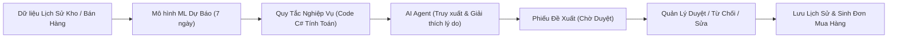

# BRIEF DỰ ÁN & ĐẶC TẢ KIẾN TRÚC: AI PROCUREMENT AGENT
## Đồ án Chuyên ngành - Khoa Công nghệ Thông tin - HUTECH

---

## 1. THÔNG TIN CHUNG & BỐI CẢNH
- **Tên đề tài**: AI Agent mua hàng và quản lý tồn kho (AI Procurement Agent).
- **Quy mô**: Đồ án chuyên ngành nhóm 3 sinh viên năm 4 (CNTT - CNPM), 12 tuần (hiện ở Tuần 1-2).
- **Thành viên nhóm (Lớp 23DTHD1)**:
  - Ngô Kế Nhật Trường (2380602390)
  - Tăng Duy Kiên (2380601131)
  - Trần Anh Hào (2380600595)
- **Giảng viên hướng dẫn**: ThS. Trịnh Công Nhựt.
- **Công nghệ đã chốt**: **C# (ASP.NET Core Web API .NET 8) + SQL Server**.
- **Quy chuẩn đặt tên**: Tiếng Việt không dấu, `snake_case` cho cột (`ma_nguyen_lieu`), `VIẾT_HOA` cho bảng (`NGUYEN_LIEU`).

---

## 2. TRIẾT LÝ & THÔNG ĐIỆP THỐNG NHẤT (ĐÃ CHỐT)
> **Hệ thống quản lý tồn kho và mua hàng có tích hợp AI — KHÔNG PHẢI chỉ là Chatbot.**

- Quản lý kho và lịch sử phê duyệt tạo nền tảng dữ liệu sạch.
- Mô hình Machine Learning ước tính nhu cầu tương lai (dự báo 7 ngày).
- Quy tắc nghiệp vụ (C#) tính toán số lượng cần mua, ROP và chấm điểm nhà cung cấp.
- AI Agent (LLM + Tool Calling) điều phối, truy xuất dữ liệu, tổng hợp đề xuất mua hàng và giải thích lý do cho con người.
- **Quản lý cửa hàng giữ quyền quyết định cuối cùng (Human-in-the-loop)**.

---

## 3. RÀNG BUỘC BẮT BUỘC (NON-NEGOTIABLE)
1. **Agent KHÔNG ĐƯỢC tự đặt hàng**: Chỉ tạo phiếu đề xuất ở trạng thái `CHO_DUYET`. Tuyệt đối không có tool hay API cho Agent tự gửi đơn đi NCC.
2. **Số liệu do CODE tính**: Toàn bộ dự báo, số lượng đề xuất, điểm NCC do code C#/ML tính. LLM chỉ truy xuất, giải thích lập luận, không tự tính nhẩm số liệu.
3. **Mọi quyết định duyệt phải có lý do**: Lưu lịch sử bất biến (Audit Log), không sửa, không xóa log.
4. **Quản lý quyết định cuối cùng**: Phê duyệt là trách nhiệm của con người.

---

## 4. TECH STACK THỐNG NHẤT
- **CSDL**: Microsoft SQL Server.
- **Backend**: ASP.NET Core Web API (.NET 8), Entity Framework Core (EF Core), LINQ.
- **Kiến trúc Solution**: Clean Architecture (Domain $\rightarrow$ Application $\rightarrow$ Infrastructure $\rightarrow$ WebApi $\rightarrow$ Web).
- **Giao diện**: Blazor / ASP.NET Core MVC (hoặc React/Next.js nếu làm tách rời).
- **Machine Learning**: ML.NET (Time Series SSA / FastTree) hoặc thuật toán C#. **Bắt buộc có Baseline (Moving Average)** để so sánh sai số (MAE, MAPE).
- **AI Agent**: Claude API / OpenAI / Gemini API qua C# SDK / HttpClient, dùng cơ chế **Tool Calling (Function Calling)**.
- **Tác vụ nền (Background Jobs)**: Hangfire hoặc `IHostedService / BackgroundService` (quét ROP, chạy dự báo định kỳ).
- **Xác thực & Phân quyền**: ASP.NET Core Identity + JWT (Quản lý mua hàng, Quản lý chi nhánh, Nhân viên kho).

---

## 5. CƠ SỞ DỮ LIỆU & ERD

### 5.1. 11 Bảng nền tảng của nhóm (Đã có)
1. `NGUYEN_LIEU` (`ma_nguyen_lieu` PK, `ten_nguyen_lieu`, `don_vi_tinh`, `muc_ton_toi_thieu`, `ton_kho_an_toan`, `trang_thai`)
2. `NHA_CUNG_CAP` (`ma_nha_cung_cap` PK, `ten_nha_cung_cap`, `nguoi_lien_he`, `so_dien_thoai`, `phi_giao_hang`, `thoi_gian_giao_du_kien`, `trang_thai`)
3. `CC_NGUYEN_LIEU` (`ma_nha_cung_cap` PK/FK, `ma_nguyen_lieu` PK/FK, `don_gia`, `so_luong_dat_toi_thieu`, `quy_cach_dong_goi`, `ngay_cap_nhat_gia`)
4. `LO_HANG` (`ma_lo_hang` PK, `ma_nguyen_lieu` FK, `ma_lo`, `so_luong_nhap`, `so_luong_con_lai`, `ngay_nhap`, `han_su_dung`, `don_gia_nhap`)
5. `GIAO_DICH_KHO` (`ma_giao_dich` PK, `ma_nguyen_lieu` FK, `ma_lo_hang` FK, `ma_nguoi_dung` FK, `loai_giao_dich`, `so_luong_thay_doi`, `thoi_gian`, `ghi_chu`)
6. `DU_BAO_NHU_CAU` (`ma_du_bao` PK, `ma_nguyen_lieu` FK, `ngay_du_bao`, `so_ngay_du_bao`, `so_luong_du_bao`, `ten_mo_hinh`, `thoi_gian_tao`)
7. `NGUOI_DUNG` (`ma_nguoi_dung` PK, `ho_ten`, `email`, `mat_khau_ma_hoa`, `vai_tro`, `trang_thai`)
8. `PHIEU_DE_XUAT_MUA` (`ma_phieu_de_xuat` PK, `ma_nguoi_tao` FK, `ngay_tao`, `trang_thai`, `tong_tien_du_kien`, `ly_do_tong_quat`, `nguon_tao`)
9. `CT_DE_XUAT_MUA` (`ma_chi_tiet` PK, `ma_phieu_de_xuat` FK, `ma_nguyen_lieu` FK, `ma_nha_cung_cap` FK, `ma_du_bao` FK, `so_luong_de_xuat`, `don_gia_tai_thoi_diem_de_xuat`, `thanh_tien`, `ly_do_de_xuat`)
10. `DON_MUA_HANG` (`ma_don_mua` PK, `ma_phieu_de_xuat` FK, `ngay_dat`, `trang_thai`, `tong_tien_thuc_te`, `ngay_nhan_hang`)
11. `LICH_SU_DUYET` (`ma_lich_su` PK, `ma_phieu_de_xuat` FK, `ma_nguoi_duyet` FK, `hanh_dong`, `ly_do`, `thoi_gian_thuc_hien`)

### 5.2. Các bảng đề xuất mở rộng (Cần thống nhất khi triển khai)
- `MON_AN`, `CONG_THUC` (BOM định mức nguyên liệu/ly nước) & `LICH_SU_BAN_HANG` (hóa đơn bán POS).
- `LAN_CHAY_MO_HINH`: Lưu vết MAE/MAPE của từng lần huấn luyện mô hình so với baseline.
- `CAU_HINH_QUY_TAC`: Trọng số chấm NCC (giá, lead time, uy tín), hệ số tồn an toàn.
- `CANH_BAO_TON_KHO`: Nhật ký cảnh báo thiếu/dư/sắp hết hạn.
- `NHAT_KY_AGENT`: Lưu câu hỏi của người dùng, tool đã gọi, phản hồi của LLM.
- `CHI_NHANH` (Nếu bài toán quản lý chuỗi nhiều chi nhánh).

---

## 6. QUY TẮC NGHIỆP VỤ & CÔNG THỨC (CODE C# THỰC THI)
1. **Cảnh báo thiếu**: 
   $$\text{Tồn kho hiện tại} < \text{Mức tồn tối thiểu} \quad \text{hoặc} \quad < \text{Nhu cầu dự báo trong thời gian Lead Time của NCC}$$
2. **Cảnh báo dư / Hạn sử dụng**: 
   $$\text{Tồn kho} > \text{Mức tồn tối đa} \quad \text{hoặc tồn kho lớn hơn nhiều ngày so với HSD lô hàng}$$
3. **Số lượng đề xuất mua**:
   $$\text{Lượng đề xuất} = \max(0, \text{Nhu cầu 7 ngày} + \text{Tồn an toàn} - \text{Tồn hiện tại})$$
   *(Làm tròn lên theo bội số của `so_luong_dat_toi_thieu` - MOQ)*.
4. **Chấm điểm chọn Nhà Cung Cấp**:
   $$\text{Score}(k) = w_{\text{giá}} \times \frac{\text{Giá}_{\min}}{\text{Giá}_k} + w_{\text{lead}} \times \frac{\text{LeadTime}_{\min}}{\text{LeadTime}_k} + w_{\text{uy tín}} \times \frac{\text{UyTín}_k}{100}$$
5. **Vòng đời Phiếu đề xuất**:
   `Nháp` $\rightarrow$ `Chờ duyệt` $\rightarrow$ `Đã duyệt` / `Từ chối` / `Cần sửa`. 
   Chỉ khi chuyển sang `Đã duyệt` mới được phép tạo `DON_MUA_HANG`.

---

## 7. CÔNG CỤ CỦA AI AGENT (TOOL CALLING SCHEMAS)
Agent được cấp các Tool đọc/ghi an toàn:
1. `lay_danh_sach_canh_bao_ton_kho()`: Lấy nguyên liệu đang dưới ngưỡng an toàn/ROP.
2. `lay_du_bao_nhu_cau(ma_nguyen_lieu)`: Lấy bảng dự báo 7 ngày tới (kết quả do ML sinh).
3. `lay_bao_gia_nha_cung_cap(ma_nguyen_lieu)`: Lấy giá, MOQ, lead time, điểm uy tín của các NCC.
4. `tao_phieu_de_xuat_mua(du_lieu_phieu)`: Ghi nhận phiếu đề xuất ở trạng thái `CHO_DUYET` kèm lý do giải thích.
*(Tuyệt đối không có tool `dat_hang_ncc` hay `thanh_toan`)*.
