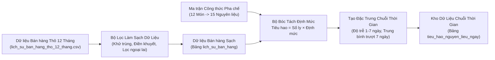

# Tuần 5 – Thu Thập, Làm Sạch Dữ Liệu & Xây Dựng Quy Trình Bóc Tách Định Mức Nguyên Liệu (BOM)

**Người thực hiện:** Ngô Kế Nhật Trường – MSSV: `2380602390` *(Phụ trách Dữ liệu & Trí tuệ nhân tạo)*  
**Đề tài:** Hệ thống Quản lý tồn kho và Đề xuất mua hàng thông minh cho Quán cà phê  
**Giảng viên hướng dẫn:** ThS. Trịnh Công Nhựt  

---

## 1. Mục tiêu công việc Tuần 5

Trong kiến trúc hệ thống đề xuất mua hàng thông minh, mô hình dự báo chuỗi thời gian (Tuần 6) và thuật toán tối ưu điểm đặt hàng lại (Tuần 7) phụ thuộc trực tiếp vào độ chính xác của dữ liệu lịch sử tiêu hao nguyên vật liệu. Tuy nhiên, tại các quán cà phê thực tế, máy bán hàng tại quầy (POS) chỉ ghi nhận **số lượng ly đồ uống bán ra**, không ghi trực tiếp số gam cà phê hay số ml sữa đã sử dụng, đồng thời dữ liệu thô từ máy bán hàng thường xuyên xuất hiện nhiễu.

Nhiệm vụ trọng tâm ở **Tuần 5** gồm 4 hạng mục:
1. **Chuẩn hóa Ma trận Định mức Công thức Pha chế (BOM):** Thiết lập thực đơn 12 món đồ uống đặc trưng và 56 dòng định mức tiêu hao phủ kín 100% cả **15 nguyên vật liệu** trong kho.
2. **Thu thập & Giả lập dữ liệu bán hàng tại quầy 12 tháng (365 ngày):** Tích hợp quy luật mùa vụ theo tháng, chu kỳ tăng trưởng ngày cuối tuần và các kịch bản dữ liệu nhiễu thực tế (`lich_su_ban_hang_tho_12_thang.csv`).
3. **Xây dựng Quy trình Làm sạch Dữ liệu & Kiểm định Chất lượng:** Tự động phát hiện và xử lý bản ghi trùng lặp, giá trị khuyết thiếu, đơn hàng âm/lỗi và điểm ngoại lai cực đoan bằng phương pháp khoảng tứ phân vị (IQR).
4. **Bóc tách định mức nguyên liệu & Tạo đặc trưng chuỗi thời gian:** Quy đổi từ đơn bán hàng sạch sang chuỗi thời gian tiêu hao hàng ngày của 15 nguyên liệu (`5,475` điểm dữ liệu) kèm các đặc trưng trễ (`tieu_hao_hom_truoc`, `tieu_hao_7_ngay_truoc`, `trung_binh_truot_7_ngay`, `do_lech_chuan_7_ngay`) sẵn sàng cho việc huấn luyện mô hình dự báo ở Tuần 6.

---

## 2. Sơ đồ Quy trình Xử lý Dữ liệu & Bóc tách Định mức

### Công thức toán học Bóc tách Định mức Nguyên liệu
Với tập thực đơn $M = \{1, 2, \dots, 12\}$ và tập nguyên vật liệu $I = \{1, 2, \dots, 15\}$, lượng nguyên liệu $i \in I$ tiêu hao trong ngày $t$ được xác định bởi phép nhân ma trận:

$$\text{Tiêu hao}(i, t) = \sum_{m \in M} \text{Số ly bán sạch}(m, t) \times \text{Định mức công thức}(m, i)$$

---

## 3. Quy trình Làm sạch Dữ liệu & Kết quả Kiểm định Thực tế

Hàm `lam_sach_du_lieu_ban_hang` trong [`dich_vu_dinh_muc_bom.py`](file:///c:/Users/truon/OneDrive/Máy tính/DACN/backend/app/services/dich_vu_dinh_muc_bom.py) thực thi 5 bước kiểm định tự động trên tập dữ liệu bán hàng 365 ngày:

| Bước xử lý | Kỹ thuật áp dụng | Số bản ghi phát hiện | Hành động của quy trình |
| :--- | :--- | :---: | :--- |
| **1. Khử trùng lặp** | Đối chiếu khóa phức hợp `(ma_hoa_don_pos, ma_mon)` do lỗi đường truyền gửi đúp | `16` dòng | Loại bỏ bản ghi trùng, giữ bản ghi gốc đầu tiên |
| **2. Xử lý khuyết thiếu** | Kiểm tra `ngay_ban`, `so_luong_ly`, `don_gia_ban` bị rỗng | `10` dòng | Tự động điền `don_gia_ban` từ bảng giá thực đơn; loại bỏ dòng mất số lượng ly |
| **3. Lọc giá trị âm / lỗi** | Kiểm tra điều kiện `so_luong_ly <= 0` (đơn lỗi/nhập nhầm) | `7` dòng | Loại bỏ khỏi tập tính tiêu hao thực tế |
| **4. Xử lý ngoại lai (IQR)** | Ngưỡng trên $\text{Ngưỡng} = Q_3 + 3.0 \times (Q_3 - Q_1)$ theo từng món | `9` dòng | Đưa các dòng kẹt phím máy bán hàng (`999` ly) về mức trung vị nhân hệ số thứ trong tuần |
| **5. Chuẩn hóa & Tổng hợp** | Chuẩn hóa kiểu ngày tháng, số thực, tính `thanh_tien` | **4,385 / 4,413** | Tỷ lệ dữ liệu sạch đạt **99.37%** |

---

## 4. Ma trận Thực đơn 12 Món & Định mức Công thức (Phủ 100% 15 Nguyên liệu)

| Mã | Tên món đồ uống | Giá bán | Giá vốn định mức | Tỷ suất lãi gộp | Định mức nguyên liệu cấu thành (cho 1 ly) |
| :-: | :--- | :---: | :---: | :---: | :--- |
| `01` | Cà phê Đen Đá Buôn Ma Thuột | 29,000đ | 4,355đ | 84.98% | 25g Robusta (`#1`), 1 Ly nhựa PET (`#14`), 1 Ống hút giấy (`#15`) |
| `02` | Cà phê Sữa Đá Sài Gòn | 35,000đ | 5,960đ | 82.97% | 22g Robusta (`#1`), 0.03 lon Sữa đặc (`#4`), 1 Ly (`#14`), 1 Ống hút (`#15`) |
| `03` | Bạc Xỉu Đá Đà Lạt | 39,000đ | 8,325đ | 78.65% | 15g Robusta (`#1`), 0.035 lon Sữa đặc (`#4`), 0.08 chai Sữa Đà Lạt Milk (`#5`), Ly, Ống hút |
| `04` | Cà phê Sữa Tươi Pha Máy | 49,000đ | 11,870đ | 75.78% | 20g Arabica (`#2`), 0.18 hộp Sữa tươi 1L (`#3`), 1 Ly (`#14`), 1 Ống hút (`#15`) |
| `05` | Cà phê Bọt Sữa Ý Cầu Đất | 49,000đ | 10,840đ | 77.88% | 18g Arabica (`#2`), 0.15 hộp Sữa tươi (`#3`), 3g Bột Cacao (`#9`), Ly, Ống hút |
| `06` | Cà phê Socola Đá Xay | 55,000đ | 15,535đ | 71.75% | 18g Arabica (`#2`), 0.1 hộp Sữa tươi (`#3`), 0.025 chai Xốt Socola (`#8`), 20g Bột đá xay (`#11`), Ly, Ống hút |
| `07` | Trà Đào Cam Sả Đặc Biệt | 45,000đ | 11,355đ | 74.77% | 15g Trà Đen Phúc Long (`#12`), 0.04 chai Siro Đào Monin (`#6`), Ly, Ống hút |
| `08` | Trà Dâu Tằm Pha Lê Tuyết | 45,000đ | 11,830đ | 73.71% | 15g Trà Ô Long (`#13`), 0.04 chai Siro Dâu Torani (`#7`), Ly, Ống hút |
| `09` | Trà Sữa Ô Long Bảo Lộc | 45,000đ | 9,050đ | 79.89% | 18g Trà Ô Long (`#13`), 0.025 lon Sữa đặc (`#4`), 0.07 chai Sữa Đà Lạt Milk (`#5`), Ly, Ống hút |
| `10` | Trà Xanh Sữa Nhật Bản | 52,000đ | 14,830đ | 71.48% | 12g Bột Matcha Uji (`#10`), 0.16 hộp Sữa tươi (`#3`), 0.015 lon Sữa đặc (`#4`), Ly, Ống hút |
| `11` | Trà Xanh Đá Xay Kem Tuyết | 59,000đ | 17,030đ | 71.14% | 15g Bột Matcha Uji (`#10`), 0.1 chai Sữa Đà Lạt Milk (`#5`), 25g Bột đá xay (`#11`), Ly, Ống hút |
| `12` | Cacao Socola Đắk Lắk Đá | 45,000đ | 13,430đ | 70.16% | 25g Bột Cacao (`#9`), 0.02 chai Xốt Socola (`#8`), 0.025 lon Sữa đặc (`#4`), 0.1 hộp Sữa tươi (`#3`), Ly, Ống hút |

---

## 5. Danh sách Tệp Mã nguồn & Dữ liệu Tiếng Việt đã tạo ở Tuần 5

* [`backend/app/models/recipe.py`](file:///c:/Users/truon/OneDrive/Máy tính/DACN/backend/app/models/recipe.py): Mở rộng cơ sở dữ liệu với 3 bảng mới (`lich_su_ban_hang`, `tieu_hao_nguyen_lieu_ngay`, `nhat_ky_xu_ly_du_lieu`).
* [`backend/app/schemas/dinh_muc_bom.py`](file:///c:/Users/truon/OneDrive/Máy tính/DACN/backend/app/schemas/dinh_muc_bom.py): Khai báo cấu trúc dữ liệu đầu vào/đầu ra bằng Tiếng Việt cho định mức BOM, mô phỏng tiêu hao, báo cáo chất lượng dữ liệu và chuỗi thời gian.
* [`backend/app/services/dich_vu_dinh_muc_bom.py`](file:///c:/Users/truon/OneDrive/Máy tính/DACN/backend/app/services/dich_vu_dinh_muc_bom.py): Toàn bộ xử lý sinh dữ liệu bán hàng thô, làm sạch ngoại lai, bóc tách định mức BOM và tạo đặc trưng chuỗi thời gian.
* [`backend/app/api/v1/endpoints/dinh_muc_bom.py`](file:///c:/Users/truon/OneDrive/Máy tính/DACN/backend/app/api/v1/endpoints/dinh_muc_bom.py): Các điểm cuối giao tiếp phục vụ truy vấn và kích hoạt quy trình dữ liệu.
* [`backend/chay_quy_trinh_bom.py`](file:///c:/Users/truon/OneDrive/Máy tính/DACN/backend/chay_quy_trinh_bom.py): Tệp thực thi độc lập từ dòng lệnh và xuất báo cáo tổng hợp.
* [`backend/du_lieu/du_lieu_tho/lich_su_ban_hang_tho_12_thang.csv`](file:///c:/Users/truon/OneDrive/Máy tính/DACN/backend/du_lieu/du_lieu_tho/lich_su_ban_hang_tho_12_thang.csv): Tập dữ liệu bán hàng POS thô 12 tháng (4,413 dòng).
* [`backend/du_lieu/du_lieu_sach/lich_su_ban_hang_sach_12_thang.csv`](file:///c:/Users/truon/OneDrive/Máy tính/DACN/backend/du_lieu/du_lieu_sach/lich_su_ban_hang_sach_12_thang.csv): Tập dữ liệu bán hàng POS sau khi làm sạch (4,385 dòng).
* [`backend/du_lieu/du_lieu_sach/tieu_hao_nguyen_lieu_ngay_12_thang.csv`](file:///c:/Users/truon/OneDrive/Máy tính/DACN/backend/du_lieu/du_lieu_sach/tieu_hao_nguyen_lieu_ngay_12_thang.csv): Tập dữ liệu chuỗi thời gian tiêu hao hàng ngày (5,475 dòng) sẵn sàng cho Tuần 6.
