# Tuần 6 – Xây Dựng, Huấn Luyện & Đánh Giá Mô Hình Dự Báo Nhu Cầu Nguyên Liệu AI (Demand Forecasting 7 Ngày)

**Người thực hiện:** Ngô Kế Nhật Trường – MSSV: `2380602390` *(Phụ trách Dữ liệu & Trí tuệ nhân tạo)*  
**Đề tài:** Hệ thống Quản lý tồn kho và Đề xuất mua hàng thông minh cho Quán cà phê (AI Procurement Agent)  
**Giảng viên hướng dẫn:** ThS. Trịnh Công Nhựt  

---

## 1. Mục tiêu công việc Tuần 6

Tiếp nối dữ liệu chuỗi thời gian tiêu hao nguyên liệu sạch 12 tháng đã bóc tách từ định mức BOM ở Tuần 5 (`5,475` điểm dữ liệu phủ kín **15 nguyên vật liệu** trong `365` ngày), nhiệm vụ trọng tâm ở **Tuần 6** gồm 5 hạng mục:

1. **Chẩn đoán thống kê chuỗi thời gian (Time-Series Diagnostics):** Kiểm tra khuyết thiếu, tính dừng (stationarity), hệ số tự tương quan (ACF lag-1, lag-7) và cường độ mùa vụ tuần/năm trên toàn bộ 15 nguyên liệu.
2. **Thiết lập khung đánh giá chống rò rỉ dữ liệu (Zero-Leakage Chronological Evaluation):** Phân chia chặt chẽ theo trình tự thời gian **Train (275 ngày) → Validation (45 ngày) → Holdout Test (45 ngày)** kết hợp cơ chế **Rolling-Origin 7-Day Horizon** (dự báo đồng thời 7 ngày tới tại mỗi mốc mà chỉ dùng lịch sử $\le t_0$).
3. **Huấn luyện & So sánh 5 mô hình (2 Baseline + 3 Machine Learning):** Đối sánh công bằng giữa `Baseline_MA7` (bắt buộc), `Seasonal_Naive_7D`, `HoltWinters_Seasonal`, `Fourier_Ridge_ML` và `Ensemble_HW_Ridge` thông qua các độ đo **MAE, RMSE, MAPE, sMAPE, $R^2$**, khoảng tin cậy **Bootstrap 95% CI** và phân tích lát cắt **Ngày thường vs Cuối tuần**.
4. **Huấn luyện lại toàn bộ & Nạp dự báo thật 7 ngày cho 15/15 nguyên liệu:** Lưu kết quả dự báo kèm khoảng tin cậy 95% vào bảng `du_bao_nhu_cau`, lưu vết lịch sử huấn luyện vào `lan_chay_mo_hinh` và chi tiết đánh giá vào `ket_qua_danh_gia_mo_hinh`, loại bỏ hoàn toàn chế độ *"Ước tính tạm"* trên Dashboard và công thức ROP.
5. **Xây dựng hệ thống API Dự báo AI (`/api/v1/du-bao-ai/*`) & Xuất báo cáo CSV/JSON:** Cung cấp giao tiếp chuẩn cho Backend (tính ROP/Đề xuất mua) và Frontend (vẽ biểu đồ Thực tế vs Dự báo và bảng so sánh mô hình).

---

## 2. Kiến trúc Quy trình Huấn luyện & Dự báo Tuần 6

```mermaid
flowchart LR
    A["Chuỗi Tiêu Hao Sạch 12 Tháng\n(tieu_hao_nguyen_lieu_ngay\n15 NL × 365 ngày)"] --> B["Chẩn Đoán Chuỗi Thời Gian\n(Khuyết thiếu, ACF-7, Tính dừng)"]
    B --> C["Chia Tập Theo Thời Gian\nTrain 275d | Val 45d | Test 45d"]
    C --> D["Tinh Chỉnh Siêu Tham Số trên Val\n5 Mô Hình (2 Baseline + 3 ML)"]
    D --> E["Đánh Giá Holdout Test (Rolling 7N)\nMAE, RMSE, MAPE, R², Bootstrap CI"]
    E --> F["Chọn Mô Hình Tốt Nhất (theo Val)\n& Retrain 100% Dữ Liệu 365 Ngày"]
    F --> G["Dự Báo 7 Ngày Tới (105 Dòng)\n+ Khoảng Tin Cậy 95%"]
    G --> H["Lưu CSDL (du_bao_nhu_cau,\nlan_chay_mo_hinh) & API /du-bao-ai"]
```

---

## 3. Chẩn đoán Chuỗi Thời Gian & Lựa chọn Mô hình

Phân tích thực nghiệm trên chuỗi tiêu hao 365 ngày (ví dụ đại diện **Hạt cà phê Robusta Buôn Ma Thuột – `#1`**):

* **Tính toàn vẹn:** `365/365` ngày liên tục, `0` giá trị khuyết thiếu hoặc âm.
* **Thống kê mô tả:** Trung bình `4.439 kg/ngày`, độ lệch chuẩn `0.963 kg/ngày` (min `2.879 kg`, max `7.241 kg`).
* **Tính mùa vụ tuần rất mạnh:** Hệ số tự tương quan tại độ trễ 7 ngày đạt $\text{ACF}(\text{lag}=7) = \mathbf{0.9075}$ (so với $\text{ACF}(\text{lag}=1) = 0.4887$). Tiêu hao trung bình cuối tuần (Thứ 7 – Chủ Nhật) tăng **+42.1%** so với ngày thường (Thứ 2 – Thứ 6).
* **Tính dừng & mùa vụ năm:** Mức tiêu thụ dịch chuyển theo mùa vụ tháng (cao điểm cuối năm T11–T1 và giữa hè T5, thấp điểm mùa mưa T8–T9), do đó mô hình cần biểu diễn được đồng thời **xu hướng mức tiêu thụ cục bộ**, **chu kỳ tuần $m=7$** và **sóng mùa vụ năm**.

### Cơ sở toán học 5 mô hình được triển khai trong [`dich_vu_du_bao_ai.py`](file:///c:/Users/truon/OneDrive/Máy tính/DACN/backend/app/services/dich_vu_du_bao_ai.py)

1. **`Baseline_MA7` (Baseline bắt buộc – Trung bình trượt 7 ngày):**
   $$\hat{y}_{t_0+h} = \frac{1}{7}\sum_{k=0}^{6} y_{t_0-k}, \quad h \in \{1..7\}$$
2. **`Seasonal_Naive_7D` (Baseline mùa vụ tuần):**
   $$\hat{y}_{t_0+h} = y_{t_0+h-7}$$
3. **`HoltWinters_Seasonal` (San bằng mũ bậc 3 có mùa vụ nhân $m=7$ & xu hướng giảm chấn $\phi$):**
   $$L_t = \alpha \frac{y_t}{S_{t \bmod 7}} + (1-\alpha)(L_{t-1} + \phi T_{t-1}), \quad T_t = \beta(L_t - L_{t-1}) + (1-\beta)\phi T_{t-1}$$
   $$S_{t \bmod 7} = \gamma \frac{y_t}{L_t} + (1-\gamma)S_{t \bmod 7}, \quad \hat{y}_{t_0+h} = \left(L_{t_0} + \sum_{k=1}^{h}\phi^k T_{t_0}\right) S_{(t_0+h)\bmod 7}$$
   *(Các siêu tham số $\alpha, \beta, \gamma, \phi$ được tìm lưới tối ưu trên tập Validation).*
4. **`Fourier_Ridge_ML` (Hồi quy Ridge L2 phong cách Prophet + Đặc trưng trễ nhân quả):**
   $$\hat{w} = (X^T X + \lambda D)^{-1} X^T y$$
   Sử dụng 14 đặc trưng chuẩn hóa (`StandardScaler` fit **duy nhất trên tập Train**): xu hướng chuẩn hóa $t/N$, 6 biến giả thứ trong tuần, 4 thành phần sóng Fourier chu kỳ năm ($\sin/\cos$ bậc 1, 2 với $P=365.25$), cùng các đặc trưng trễ nhân quả `lag_7`, `lag_14` và `rolling_mean_7` (cập nhật đệ quy khi dự báo đa bước $h=1..7$).
5. **`Ensemble_HW_Ridge` (Tổ hợp có trọng số tối ưu trên Validation):**
   $$\hat{y}^{\text{ens}}_{t_0+h} = w \cdot \hat{y}^{\text{HW}}_{t_0+h} + (1-w) \cdot \hat{y}^{\text{Ridge}}_{t_0+h}$$

---

## 4. Kết quả Thực nghiệm & Đối sánh 5 Mô hình (Holdout Test 45 ngày)

Toàn bộ 5 mô hình được đánh giá đồng nhất trên cùng 15 nguyên liệu, cùng tập Holdout Test 45 ngày (cuối chuỗi) với cơ chế **Rolling-Origin 7-Day Forecast**. Thời gian huấn luyện & kiểm thử trọn gói cả 15 nguyên liệu chỉ mất **2.898 giây**.

| Hạng | Tên mô hình | Nhóm | Val MAPE (%) | Test MAPE (%) | 95% Bootstrap CI (MAPE) | Test sMAPE (%) | Test $R^2$ | MAPE Ngày thường | MAPE Cuối tuần | Giảm sai số so với Baseline | Số NL thắng |
| :-: | :--- | :-: | :-: | :-: | :-: | :-: | :-: | :-: | :-: | :-: | :-: |
| **1** | **`Ensemble_HW_Ridge`** | **ML** | **5.17%** | **5.72%** | **[5.07%, 6.33%]** | **5.82%** | **0.8589** | **5.78%** | **5.60%** | **-63.53%** | **9 / 15** |
| **2** | `HoltWinters_Seasonal` | ML | 5.22% | 5.81% | [5.10%, 6.51%] | 5.95% | 0.8499 | 5.87% | 5.67% | -62.98% | 5 / 15 |
| **3** | `Fourier_Ridge_ML` | ML | 5.40% | 5.98% | [5.53%, 6.41%] | 6.00% | 0.8583 | 6.11% | 5.69% | -61.90% | 1 / 15 |
| **4** | `Seasonal_Naive_7D` | Baseline | 7.23% | 6.96% | [6.11%, 7.74%] | 7.14% | 0.7776 | 6.88% | 7.12% | -55.63% | 0 / 15 |
| **5** | `Baseline_MA7` | Baseline | 16.59% | 15.69% | [15.38%, 15.96%] | 15.96% | 0.0645 | 12.59% | 22.53% | 0.00% | 0 / 15 |

### Nhận xét chuyên môn từ bảng đối sánh
* **Vượt trội có ý nghĩa thống kê so với Baseline bắt buộc (`Baseline_MA7`):** Hệ thống chọn mô hình ML tự động đạt **Test MAPE trung bình 5.72%** (mục tiêu đồ án $< 15\%$), **giảm 63.54% sai số** so với `Baseline_MA7` (`15.69%`), đồng thời **MAE trung bình giảm từ 12.5798 xuống 3.0149** và **RMSE giảm từ 15.3832 xuống 4.7228**. Hai khoảng tin cậy Bootstrap 95% (`[5.07%, 6.33%]` vs `[15.38%, 15.96%]`) tách biệt hoàn toàn.
* **Phân tích lát cắt Ngày thường vs Cuối tuần (Slice Analysis):** `Baseline_MA7` sai số rất nặng vào cuối tuần (**22.53%**) vì trung bình trượt làm phẳng đỉnh tiêu thụ Thứ 7 – Chủ Nhật, dễ gây đứt hàng đúng lúc đông khách nhất. Các mô hình ML đã kéo sai số cuối tuần xuống còn **5.60% – 5.69%**, thậm chí thấp hơn cả ngày thường!
* **Hiệu quả của Ensemble:** Tổ hợp `Ensemble_HW_Ridge` thắng trên **9/15 nguyên liệu**, đạt cả Test MAPE thấp nhất (`5.72%`) lẫn hệ số xác định $R^2$ cao nhất (`0.8589`), nhờ kết hợp khả năng bám sát biến động cục bộ của Holt-Winters với sóng mùa vụ năm ổn định của Fourier Ridge.

---

## 5. Kết quả Dự báo Nhu cầu 7 Ngày Tới cho Toàn bộ 15/15 Nguyên liệu

Sau khi chọn mô hình tối ưu trên tập Validation, từng mô hình được **huấn luyện lại trên 100% dữ liệu 365 ngày** để sinh `105` dòng dự báo (`15 nguyên liệu × 7 ngày`) nạp vào bảng `du_bao_nhu_cau`:

| Mã | Tên nguyên liệu | Mô hình được chọn | Test MAPE | Giảm sai số vs Baseline | Tổng dự báo 7 ngày | Đơn vị | Ngày cao điểm |
| :-: | :--- | :--- | :-: | :-: | :-: | :-: | :-: |
| `01` | Hạt cà phê Robusta Buôn Ma Thuột | `Ensemble_HW_Ridge` | 5.78% | -63.56% | **33.13** | kg | CN (29/11) |
| `02` | Hạt cà phê Arabica Cầu Đất | `HoltWinters_Seasonal` | 4.92% | -66.82% | **14.20** | kg | CN (29/11) |
| `03` | Sữa tươi tiệt trùng Barista 1L | `HoltWinters_Seasonal` | 4.47% | -69.53% | **177.27** | hộp | CN (29/11) |
| `04` | Sữa đặc Phương Nam 1.284kg | `Ensemble_HW_Ridge` | 5.29% | -65.31% | **54.80** | lon | CN (29/11) |
| `05` | Sữa tươi thanh trùng Đà Lạt Milk 950ml | `Fourier_Ridge_ML` | 6.21% | -60.77% | **81.32** | chai | CN (29/11) |
| `06` | Siro Đào Monin 700ml | `Ensemble_HW_Ridge` | 7.13% | -55.47% | **20.50** | chai | CN (29/11) |
| `07` | Siro Dâu Torani 750ml | `Ensemble_HW_Ridge` | 6.84% | -57.59% | **12.33** | chai | CN (29/11) |
| `08` | Xốt Socola Hershey 1.36kg | `Ensemble_HW_Ridge` | 5.02% | -68.21% | **9.17** | chai | CN (29/11) |
| `09` | Bột Cacao Nguyên Chất Đắk Lắk | `Ensemble_HW_Ridge` | 7.59% | -53.41% | **5.95** | kg | CN (29/11) |
| `10` | Bột Matcha Uji Nhật Bản | `HoltWinters_Seasonal` | 5.90% | -62.94% | **5.92** | kg | CN (29/11) |
| `11` | Bột Frappe Base tạo sánh | `Ensemble_HW_Ridge` | 6.13% | -63.75% | **8.59** | kg | CN (29/11) |
| `12` | Trà Đen Phúc Long Đặc Biệt | `Ensemble_HW_Ridge` | 7.13% | -55.47% | **7.69** | kg | CN (29/11) |
| `13` | Trà Ô Long Kim Tuyên Bảo Lộc | `Ensemble_HW_Ridge` | 6.23% | -60.32% | **11.86** | kg | CN (29/11) |
| `14` | Ly nhựa PET Takeaway 500ml | `HoltWinters_Seasonal` | 3.60% | -76.06% | **4,200** | cái | CN (29/11) |
| `15` | Ống hút giấy sinh học bọc màng | `HoltWinters_Seasonal` | 3.60% | -76.06% | **4,200** | cái | CN (29/11) |

### Minh họa chi tiết dự báo 7 ngày kèm Khoảng tin cậy 95% – Hạt cà phê Robusta (`#01`)

| Ngày dự báo | Thứ | Loại ngày | Dự báo (kg) | Cận dưới 95% (kg) | Cận trên 95% (kg) | Độ tin cậy | Mô hình |
| :-: | :-: | :-: | :-: | :-: | :-: | :-: | :--- |
| `2026-11-23` | T2 | Ngày thường | 3.85 | 3.21 | 4.49 | 94.2% | `Ensemble_HW_Ridge` |
| `2026-11-24` | T3 | Ngày thường | 3.97 | 3.32 | 4.63 | 93.8% | `Ensemble_HW_Ridge` |
| `2026-11-25` | T4 | Ngày thường | 4.10 | 3.43 | 4.78 | 93.4% | `Ensemble_HW_Ridge` |
| `2026-11-26` | T5 | Ngày thường | 4.33 | 3.64 | 5.01 | 93.0% | `Ensemble_HW_Ridge` |
| `2026-11-27` | T6 | Ngày thường | 4.83 | 4.13 | 5.53 | 92.6% | `Ensemble_HW_Ridge` |
| `2026-11-28` | T7 | **Cuối tuần** | **5.92** | 5.20 | 6.64 | 92.2% | `Ensemble_HW_Ridge` |
| `2026-11-29` | CN | **Cuối tuần** | **6.13** | 5.40 | 6.86 | 91.8% | `Ensemble_HW_Ridge` |

---

## 6. Hệ thống API Dự báo AI & Danh sách Tệp Mã nguồn Tuần 6

### 6.1. Các API Endpoint mới (`/api/v1/du-bao-ai`)
* `POST /api/v1/du-bao-ai/huan-luyen`: Kích hoạt chạy lại toàn bộ quy trình huấn luyện, so sánh 5 mô hình và cập nhật dự báo 7 ngày vào bảng `du_bao_nhu_cau`.
* `GET /api/v1/du-bao-ai/tong-quan`: Lấy báo cáo tổng quan lần huấn luyện gần nhất, bảng xếp hạng 5 mô hình và danh sách dự báo 7 ngày cho cả 15 nguyên liệu.
* `GET /api/v1/du-bao-ai/so-sanh-mo-hinh`: Bảng đối sánh chi tiết MAE / RMSE / MAPE / sMAPE / $R^2$ / Ngày thường vs Cuối tuần (lọc theo `ma_nguyen_lieu` hoặc `chi_lay_tot_nhat=true`).
* `GET /api/v1/du-bao-ai/du-bao-7-ngay`: Danh sách dự báo 7 ngày tới kèm cận dưới/cận trên 95% cho toàn bộ 15 nguyên liệu (lọc theo `danh_muc`).
* `GET /api/v1/du-bao-ai/nguyen-lieu/{ma_nguyen_lieu}`: Phân tích chuyên sâu 1 nguyên liệu (chẩn đoán chuỗi, so sánh 5 mô hình, chuỗi điểm **Thực tế vs Dự báo** trên tập Test 45 ngày, và dự báo 7 ngày tới).
* `GET /api/v1/du-bao-ai/lich-su-huan-luyen`: Lịch sử các lần chạy huấn luyện mô hình (`lan_chay_mo_hinh`).

### 6.2. Danh sách tệp mã nguồn & hiện vật dữ liệu đã tạo/cập nhật
* [`backend/app/models/forecast.py`](file:///c:/Users/truon/OneDrive/Máy tính/DACN/backend/app/models/forecast.py): Mở rộng CSDL thêm 2 bảng `lan_chay_mo_hinh` và `ket_qua_danh_gia_mo_hinh` (giữ nguyên tương thích 100% với bảng `du_bao_nhu_cau`).
* [`backend/app/schemas/du_bao_ai.py`](file:///c:/Users/truon/OneDrive/Máy tính/DACN/backend/app/schemas/du_bao_ai.py): Khai báo Pydantic schemas Tiếng Việt cho kết quả chẩn đoán chuỗi, bảng so sánh mô hình, dự báo 7 ngày và biểu đồ kiểm thử.
* [`backend/app/services/dich_vu_du_bao_ai.py`](file:///c:/Users/truon/OneDrive/Máy tính/DACN/backend/app/services/dich_vu_du_bao_ai.py): Toàn bộ lõi huấn luyện, chuẩn hóa đặc trưng chống rò rỉ, 5 mô hình (Baseline & ML), tinh chỉnh siêu tham số, Rolling-Origin 7-Day Evaluation, Bootstrap 95% CI và nạp dự báo vào CSDL.
* [`backend/app/api/v1/endpoints/du_bao_ai.py`](file:///c:/Users/truon/OneDrive/Máy tính/DACN/backend/app/api/v1/endpoints/du_bao_ai.py): 6 điểm cuối API phục vụ Backend, Frontend và AI Agent.
* [`backend/chay_huan_luyen_du_bao.py`](file:///c:/Users/truon/OneDrive/Máy tính/DACN/backend/chay_huan_luyen_du_bao.py): Tệp thực thi độc lập từ dòng lệnh, in báo cáo so sánh mô hình và đồng bộ DDL Tuần 6 vào `database_seed.sql`.
* [`backend/test_api.py`](file:///c:/Users/truon/OneDrive/Máy tính/DACN/backend/test_api.py): Bổ sung bộ kiểm thử tự động xác nhận ML vượt trội hơn Baseline, 15/15 nguyên liệu có dự báo thật (không còn ước tính tạm) và 100% API pass.
* [`backend/du_lieu/du_bao_ai/du_bao_nhu_cau_7_ngay.csv`](file:///c:/Users/truon/OneDrive/Máy tính/DACN/backend/du_lieu/du_bao_ai/du_bao_nhu_cau_7_ngay.csv): Tập kết quả dự báo 7 ngày (105 dòng) kèm khoảng tin cậy 95%.
* [`backend/du_lieu/du_bao_ai/bang_so_sanh_mo_hinh_tuan6.csv`](file:///c:/Users/truon/OneDrive/Máy tính/DACN/backend/du_lieu/du_bao_ai/bang_so_sanh_mo_hinh_tuan6.csv): Bảng đối sánh đầy đủ 75 dòng (`15 nguyên liệu × 5 mô hình`).
* [`backend/du_lieu/du_bao_ai/bao_cao_huan_luyen_tuan6.json`](file:///c:/Users/truon/OneDrive/Máy tính/DACN/backend/du_lieu/du_bao_ai/bao_cao_huan_luyen_tuan6.json): Báo cáo JSON tổng hợp phục vụ tích hợp nhanh.
