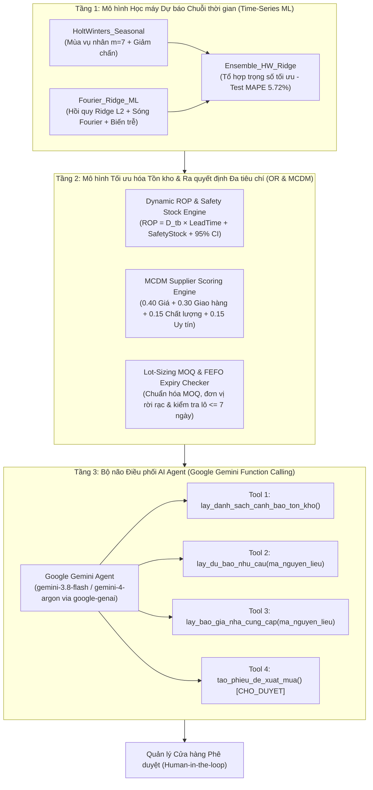

# Tuần 7 – Kế Hoạch Bổ Sung Tồn Kho (ROP, Safety Stock, MCDM) & Kiến Trúc Kết Hợp Đa Mô Hình (Hybrid Multi-Model AI Procurement Agent)

**Người thực hiện:** Ngô Kế Nhật Trường – MSSV: `2380602390` *(Phụ trách Dữ liệu & Trí tuệ nhân tạo)*  
**Đề tài:** Hệ thống Quản lý tồn kho và Đề xuất mua hàng thông minh cho Quán cà phê (AI Procurement Agent)  
**Giảng viên hướng dẫn:** ThS. Trịnh Công Nhựt  

---

## 1. Mục tiêu công việc Tuần 7

Tiếp nối kết quả huấn luyện & đánh giá 5 mô hình dự báo nhu cầu 7 ngày ở Tuần 6 (`Ensemble_HW_Ridge`, `HoltWinters_Seasonal`, `Fourier_Ridge_ML`, `Seasonal_Naive_7D`, `Baseline_MA7`), trọng tâm của **Tuần 7** là chuyển hóa dự báo định lượng thành **Quyết định Kế hoạch Bổ sung Tồn kho & Điều phối AI Agent tự chủ** theo **Kiến trúc Kết hợp Đa Mô hình (Hybrid Multi-Model AI Architecture)**:

1. **Tối ưu Điểm đặt hàng lại (ROP) & Tồn kho an toàn (Safety Stock):** Kết nối trực tiếp nhu cầu dự báo trung bình ngày và cận trên khoảng tin cậy 95% của mô hình ML thắng cuộc với thời gian giao hàng (`Lead Time`) của Nhà cung cấp tối ưu.
2. **Đánh giá & Xếp hạng Nhà cung cấp Đa tiêu chí (MCDM):** Chấm điểm tự động trên 4 chiều: Đơn giá ($40\%$), Thời gian giao hàng ($30\%$), Điểm chất lượng ($15\%$) và Điểm uy tín ($15\%$), đồng thời sinh lời giải trình so sánh với nhà cung cấp xếp thứ 2.
3. **Chuẩn hóa Quy tắc Lượng đặt hàng (`MOQ` & Đơn vị rời rạc) + Kiểm tra Lô hàng FEFO:** Làm tròn số lượng đặt theo bội số/ngưỡng `MOQ` của nhà cung cấp và số nguyên cho các đơn vị đóng gói rời rạc (`chai`, `hộp`, `lon`, `cái`...), kết hợp cảnh báo các lô hàng sắp hết hạn ($\le 7$ ngày) theo nguyên tắc FEFO.
4. **Xây dựng Hybrid Multi-Model AI Procurement Agent (Gemini Function Calling – 4 Tools an toàn):** Kết hợp các mô hình ML định lượng với bộ điều phối Google Gemini (`gemini-3.8-flash` / `gemini-4-argon` qua SDK `google-genai`) sử dụng cơ chế **Function Calling**, đảm bảo 0% sai số tính nhẩm (hallucination) và tuân thủ tuyệt đối cơ chế **Human-in-the-loop** (chỉ tạo phiếu ở trạng thái `CHO_DUYET`).
5. **Mở hệ thống API Kế hoạch bổ sung (`/api/v1/bo-sung/*`):** Đồng bộ 100% cấu trúc dữ liệu với giao diện Tuần 7 trên Frontend Reflex ([replenishment.py](file:///c:/Users/truon/OneDrive/Máy tính/DACN/frontend/frontend/replenishment.py)).

---

## 2. Kiến trúc Kết hợp Đa Mô hình (Hybrid Multi-Model AI Architecture)

Thay vì để một mô hình LLM tự tính nhẩm số liệu (dễ gây sai số học và không thể tái lập), hệ thống phân tách rõ **3 tầng mô hình chuyên biệt**:

### Bảng phân vai các mô hình trong kiến trúc Hybrid

| Tầng | Tên Mô hình / Giải thuật | Loại Mô hình | Vai trò chính |
| :--- | :--- | :--- | :--- |
| **Tầng 1** | `Ensemble_HW_Ridge`, `HoltWinters_Seasonal`, `Fourier_Ridge_ML` | Time-Series Machine Learning | Dự báo nhu cầu tiêu hao 7 ngày tới kèm khoảng tin cậy 95% (Test MAPE trung bình **5.72%**, $R^2 = \mathbf{0.8589}$). |
| **Tầng 2** | `Dynamic ROP & Safety Stock Engine` | Inventory Optimization | Tính điểm đặt hàng lại $\text{ROP}$, tồn an toàn gợi ý từ biên độ 95% CI và chuẩn hóa lượng đặt theo `MOQ` + đơn vị rời rạc. |
| **Tầng 2** | `MCDM Supplier Scoring` | Multi-Criteria Decision Making | Xếp hạng nhà cung cấp trên thang 100 điểm từ 4 tiêu chí (Đơn giá, Lead time, Chất lượng, Uy tín). |
| **Tầng 3** | `gemini-3.8-flash` / `gemini-4-argon` | Agentic LLM (Function Calling) | Tự động gọi 4 Tools truy xuất kết quả từ Tầng 1 & Tầng 2, kiểm tra chéo hạn dùng FEFO và tổng hợp phiếu đề xuất `CHO_DUYET`. |

---

## 3. Cơ sở Toán học Tầng Tối ưu hóa Tồn kho & MCDM (Tuần 7)

Được cài đặt trong [`dich_vu_ke_hoach_bo_sung.py`](file:///c:/Users/truon/OneDrive/Máy tính/DACN/backend/app/services/dich_vu_ke_hoach_bo_sung.py):

1. **Chấm điểm Nhà cung cấp Đa tiêu chí (MCDM):**
   Với tập các nhà cung cấp $K_i$ có báo giá cho nguyên liệu $i$:
   $$\text{Score}(k) = 100 \times \left( 0.40 \frac{P_{\min}}{P_k} + 0.30 \frac{L_{\min}}{L_k} + 0.15 \frac{Q_k}{5.0} + 0.15 \frac{R_k}{R_{\max}} \right)$$
   Nhà cung cấp tối ưu $k^* = \arg\max_{k \in K_i} \text{Score}(k)$ cung cấp thời gian giao hàng chuẩn $L_{i, k^*}$ và số lượng đặt tối thiểu $\text{MOQ}_{i, k^*}$.

2. **Điểm đặt hàng lại (Reorder Point – ROP) & Safety Stock gợi ý AI:**
   $$\bar{D}_i^{\text{ML}} = \frac{1}{7}\sum_{h=1}^{7} \hat{y}_{i, t_0+h}^{\text{ML}}, \qquad \text{ROP}_i = \bar{D}_i^{\text{ML}} \times L_{i, k^*} + SS_i$$
   Đồng thời hệ thống tính mức tồn an toàn gợi ý theo độ bất định 95% CI của mô hình ML trong thời gian giao hàng:
   $$SS_i^{\text{AI}} = \max\left(SS_i, \; 1.65 \times \overline{\Delta\text{CI}}_{95\%} \times \sqrt{L_{i, k^*}}\right)$$

3. **Quy tắc tính Số lượng cần đặt bổ sung (Lot-Sizing với MOQ & Đơn vị rời rạc):**
   Khi $\text{Tồn hiện tại } I_i \le \text{ROP}_i$:
   $$Q_i^{\text{raw}} = \max\left(D_{i, 7\text{d}}^{\text{ML}} + SS_i - I_i, \; 1.5 \times \text{ROP}_i - I_i, \; \text{MOQ}_{i, k^*}\right)$$
   $$Q_i^* = \begin{cases} \lceil Q_i^{\text{raw}} \rceil & \text{nếu đơn vị tính } \in \{\text{chai, hộp, lon, cái, túi, gói, thùng}\} \\ \text{round}(Q_i^{\text{raw}}, 2) & \text{nếu đơn vị tính liên tục (kg, lít)} \end{cases}$$

---

## 4. Thiết kế 4 Công cụ An toàn của AI Agent (Function Calling Tools)

Theo đúng Mục 7 Đặc tả Kiến trúc ([KE_HOACH_TRIEN_KHAI_DO_AN.md](file:///c:/Users/truon/OneDrive/Máy tính/DACN/KE_HOACH_TRIEN_KHAI_DO_AN.md#L101-L107)), AI Agent chỉ được cấp 4 công cụ đọc/ghi có kiểm soát:

1. `lay_danh_sach_canh_bao_ton_kho(chi_lay_can_dat)`: Quét toàn bộ 15 nguyên liệu, trả về các mặt hàng có $\text{Tồn} \le \text{ROP}$ kèm cảnh báo lô hàng sắp hết hạn ($\le 7$ ngày) theo nguyên tắc FEFO.
2. `lay_du_bao_nhu_cau(ma_nguyen_lieu)`: Truy xuất chuỗi dự báo 7 ngày tới, cận dưới/trên 95% CI và tên mô hình ML thắng cuộc (`Ensemble_HW_Ridge`, `HoltWinters_Seasonal`, `Fourier_Ridge_ML`).
3. `lay_bao_gia_nha_cung_cap(ma_nguyen_lieu)`: Thực thi giải thuật MCDM xếp hạng các nhà cung cấp kèm đơn giá, Lead time, MOQ, chất lượng, uy tín.
4. `tao_phieu_de_xuat_mua(ly_do_tong_quan, danh_sach_mat_hang)`: Khởi tạo phiếu đề xuất mua hàng bắt buộc ở trạng thái **`CHO_DUYET`** và lưu vết toàn bộ quá trình gọi tool vào bảng `nhat_ky_ai_agent`. *(Tuyệt đối không có tool tự gửi đơn đặt hàng hay thanh toán)*.

---

## 5. Kết quả Thực nghiệm Kế hoạch Bổ sung ROP & MCDM cho 15/15 Nguyên liệu

Bảng kế hoạch bổ sung được sinh tự động khi kết hợp kết quả dự báo 7 ngày của mô hình ML thắng cuộc (Tầng 1) với công thức ROP và chấm điểm MCDM (Tầng 2):

| Mã | Tên nguyên liệu | Tồn hiện tại | Safety Stock | Điểm ROP | Dự báo 7N (ML) | Mô hình ML | Cần đặt | ĐVT | Nhà cung cấp tối ưu (MCDM) | Điểm MCDM | Thành tiền dự kiến |
| :-: | :--- | :-: | :-: | :-: | :-: | :--- | :-: | :-: | :--- | :-: | :-: |
| `01` | **Hạt cà phê Robusta Buôn Ma Thuột** | **12.50** | 15.0 | **19.75** | 33.26 | `Ensemble_HW_Ridge` | **35.76** | kg | Công ty Nguyên Liệu Pha Chế Vinbar | **95.3** | **5,542,800 ₫** |
| `02` | **Hạt cà phê Arabica Cầu Đất** | **8.50** | 10.0 | **12.13** | 14.89 | `Fourier_Ridge_ML` | **16.39** | kg | Công ty Nguyên Liệu Pha Chế Vinbar | **95.0** | **4,589,200 ₫** |
| `03` | Sữa tươi tiệt trùng Barista 1L | 120.00 | 25.0 | 50.84 | 180.88 | `Ensemble_HW_Ridge` | 0 | hộp | Đại lý Phân phối Sữa Horeca Sài Gòn | 98.5 | 0 ₫ |
| `04` | Sữa đặc Phương Nam 1.284kg | 45.00 | 20.0 | 27.85 | 54.92 | `Ensemble_HW_Ridge` | 0 | lon | Đại lý Phân phối Sữa Horeca Sài Gòn | 98.5 | 0 ₫ |
| `05` | Sữa tươi thanh trùng Đà Lạt Milk 950ml | 24.00 | 12.0 | 23.35 | 79.42 | `Ensemble_HW_Ridge` | 0 | chai | Đại lý Phân phối Sữa Horeca Sài Gòn | 98.5 | 0 ₫ |
| `06` | **Siro Đào Monin 700ml** | **10.00** | 5.0 | **10.92** | 20.74 | `Ensemble_HW_Ridge` | **16** | chai | Công ty Nguyên Liệu Pha Chế Vinbar | **97.9** | **3,440,000 ₫** |
| `07` | Siro Dâu Torani 750ml | 10.00 | 4.0 | 7.52 | 12.33 | `Ensemble_HW_Ridge` | 0 | chai | Công ty Nguyên Liệu Pha Chế Vinbar | 97.9 | 0 ₫ |
| `08` | Xốt Socola Hershey 1.36kg | 9.00 | 4.0 | 6.62 | 9.15 | `Ensemble_HW_Ridge` | 0 | chai | Công ty Nguyên Liệu Pha Chế Vinbar | 97.9 | 0 ₫ |
| `09` | Bột Cacao Nguyên Chất Đắk Lắk | 95.00 | 8.0 | 8.88 | 6.14 | `Fourier_Ridge_ML` | 0 | kg | Công ty Nguyên Liệu Pha Chế Vinbar | 94.5 | 0 ₫ |
| `10` | Bột Matcha Uji Nhật Bản | 6.50 | 3.0 | 4.70 | 5.98 | `Ensemble_HW_Ridge` | 0 | kg | Công ty Nguyên Liệu Pha Chế Vinbar | 97.9 | 0 ₫ |
| `11` | Bột Frappe Base tạo sánh | 14.00 | 5.0 | 7.48 | 8.67 | `Ensemble_HW_Ridge` | 0 | kg | Công ty Nguyên Liệu Pha Chế Vinbar | 97.9 | 0 ₫ |
| `12` | Trà Đen Phúc Long Đặc Biệt | 21.25 | 8.0 | 10.22 | 7.77 | `Ensemble_HW_Ridge` | 0 | kg | Công ty Trà Việt TeaMaster Bảo Lộc | 99.1 | 0 ₫ |
| `13` | Trà Ô Long Kim Tuyên Bảo Lộc | 16.00 | 6.0 | 9.42 | 11.98 | `Ensemble_HW_Ridge` | 0 | kg | Công ty Trà Việt TeaMaster Bảo Lộc | 99.1 | 0 ₫ |
| `14` | Ly nhựa PET Takeaway 500ml | 4,990 | 500 | 2,321 | 4,249 | `HoltWinters_Seasonal` | 0 | cái | Tổng kho Bao bì Thực phẩm Tân Bình | 96.7 | 0 ₫ |
| `15` | Ống hút giấy sinh học bọc màng | 5,990 | 600 | 2,421 | 4,249 | `HoltWinters_Seasonal` | 0 | cái | Tổng kho Bao bì Thực phẩm Tân Bình | 96.7 | 0 ₫ |

### Nhật ký 8 bước gọi Tool (Function Calling Trace) của Hybrid Multi-Model AI Agent

| Bước | Tên Tool được gọi | Mô hình / Động cơ thực thi | Tóm tắt kết quả trả về cho Agent |
| :-: | :--- | :--- | :--- |
| `01` | `lay_danh_sach_canh_bao_ton_kho` | Dynamic ROP & Safety Stock Engine + FEFO Checker | Quét 15 nguyên liệu, phát hiện 3 mặt hàng chạm ngưỡng ROP: Robusta (`12.5 ≤ 19.75 kg`), Arabica (`8.5 ≤ 12.13 kg`), Siro Đào Monin (`10.0 ≤ 10.92 chai`). |
| `02` | `lay_du_bao_nhu_cau(1)` | Time-Series ML (`Ensemble_HW_Ridge`) | Hạt cà phê Robusta: Dự báo 7 ngày tới cần `33.26 kg` (TB `4.75 kg/ngày`, độ tin cậy `93.4%`). |
| `03` | `lay_bao_gia_nha_cung_cap(1)` | MCDM Multi-Criteria Supplier Scoring | Xếp hạng 2 NCC $\rightarrow$ Chọn *Công ty Nguyên Liệu Pha Chế Vinbar* (Điểm MCDM `95.3/100`, giá `155,000 ₫/kg`, giao `1 ngày`, MOQ `5 kg`). |
| `04` | `lay_du_bao_nhu_cau(2)` | Time-Series ML (`Fourier_Ridge_ML`) | Hạt cà phê Arabica: Dự báo 7 ngày tới cần `14.89 kg` (TB `2.13 kg/ngày`, độ tin cậy `93.1%`). |
| `05` | `lay_bao_gia_nha_cung_cap(2)` | MCDM Multi-Criteria Supplier Scoring | Xếp hạng 2 NCC $\rightarrow$ Chọn *Công ty Nguyên Liệu Pha Chế Vinbar* (Điểm MCDM `95.0/100`, giá `280,000 ₫/kg`, giao `1 ngày`, MOQ `2 kg`). |
| `06` | `lay_du_bao_nhu_cau(6)` | Time-Series ML (`Ensemble_HW_Ridge`) | Siro Đào Monin 700ml: Dự báo 7 ngày tới cần `20.74 chai` (TB `2.96 chai/ngày`, độ tin cậy `91.9%`). |
| `07` | `lay_bao_gia_nha_cung_cap(6)` | MCDM Multi-Criteria Supplier Scoring | Xếp hạng 1 NCC $\rightarrow$ Chọn *Công ty Nguyên Liệu Pha Chế Vinbar* (Điểm MCDM `97.9/100`, giá `215,000 ₫/chai`, giao `2 ngày`, MOQ `2 chai`, làm tròn đơn vị rời rạc `16 chai`). |
| `08` | `tao_phieu_de_xuat_mua` | Proposal Generator (`CHO_DUYET` Guardrail) | Khởi tạo Phiếu đề xuất ở trạng thái **`CHO_DUYET`** gồm 3 mặt hàng, tổng tiền dự kiến **13,572,000 ₫**. |

---

## 6. Hệ thống API Tuần 7 & Danh sách Tệp Mã nguồn Đã Triển khai

### 5.1. Các API Endpoint mới (`/api/v1/bo-sung`)
* `GET /api/v1/bo-sung/ke-hoach`: Trả về danh sách kế hoạch bổ sung cho 15 nguyên liệu (khớp 100% với Frontend `replenishment.py`), giúp giao diện tự động chuyển từ trạng thái *"Tính tạm tại giao diện"* sang **"Dữ liệu từ API kế hoạch bổ sung"**.
* `POST /api/v1/bo-sung/tao-de-xuat`: Tạo phiếu đề xuất (`CHO_DUYET`) cho 1 nguyên liệu khi người dùng bấm nút **"Tạo đề xuất"** trên bảng ROP hoặc thẻ Nhà cung cấp được chọn.
* `POST /api/v1/bo-sung/ai-agent/chay`: Kích hoạt Hybrid Multi-Model AI Agent thực thi chuỗi Function Calling 4 Tools và trả về chi tiết từng bước suy luận.
* `GET /api/v1/bo-sung/ai-agent/kien-truc`: Trả về thông số cấu hình 3 tầng của Kiến trúc Kết hợp Đa Mô hình.
* `GET /api/v1/bo-sung/ai-agent/nhat-ky`: Truy xuất lịch sử các phiên suy luận và gọi Tool của AI Agent từ bảng `nhat_ky_ai_agent`.

### 5.2. Danh sách tệp mã nguồn & dữ liệu Tuần 7
* [`backend/app/models/proposal.py`](file:///c:/Users/truon/OneDrive/Máy tính/DACN/backend/app/models/proposal.py): Bổ sung bảng `nhat_ky_ai_agent` (`NhatKyAiAgent`) lưu vết yêu cầu đầu vào, các mô hình kết hợp, danh sách tool đã gọi và phản hồi của Agent.
* [`backend/app/schemas/bo_sung.py`](file:///c:/Users/truon/OneDrive/Máy tính/DACN/backend/app/schemas/bo_sung.py): Khai báo Pydantic schemas cho kế hoạch bổ sung ROP, yêu cầu tạo đề xuất đơn lẻ, nhật ký gọi Tool và thông tin kiến trúc Đa Mô hình.
* [`backend/app/services/dich_vu_ke_hoach_bo_sung.py`](file:///c:/Users/truon/OneDrive/Máy tính/DACN/backend/app/services/dich_vu_ke_hoach_bo_sung.py): Lõi tính toán kế hoạch bổ sung Tuần 7, tích hợp 4 Tools Function Calling với SDK `google-genai` (`gemini-3.8-flash` / `gemini-4-argon`) kèm cơ chế Hybrid Local Orchestrator tự động.
* [`backend/app/api/v1/endpoints/bo_sung.py`](file:///c:/Users/truon/OneDrive/Máy tính/DACN/backend/app/api/v1/endpoints/bo_sung.py): 5 API endpoints phục vụ Frontend Tuần 7 và kiểm định AI Agent.
* [`backend/chay_ke_hoach_bo_sung_tuan7.py`](file:///c:/Users/truon/OneDrive/Máy tính/DACN/backend/chay_ke_hoach_bo_sung_tuan7.py): Kịch bản chạy độc lập từ dòng lệnh, in bảng kế hoạch ROP 15 nguyên liệu, nhật ký gọi Tool của AI Agent và xuất báo cáo CSV/JSON.
* [`backend/du_lieu/ke_hoach_bo_sung_tuan7/ke_hoach_bo_sung_rop_tuan7.csv`](file:///c:/Users/truon/OneDrive/Máy tính/DACN/backend/du_lieu/ke_hoach_bo_sung_tuan7/ke_hoach_bo_sung_rop_tuan7.csv): Bảng kế hoạch bổ sung tồn kho & chọn nhà cung cấp MCDM cho 15 nguyên liệu.
* [`backend/du_lieu/ke_hoach_bo_sung_tuan7/bao_cao_hybrid_ai_agent_tuan7.json`](file:///c:/Users/truon/OneDrive/Máy tính/DACN/backend/du_lieu/ke_hoach_bo_sung_tuan7/bao_cao_hybrid_ai_agent_tuan7.json): Báo cáo JSON lưu chi tiết chuỗi bước gọi Tool (`function_call` / `function_result`) của Hybrid Multi-Model AI Agent.
